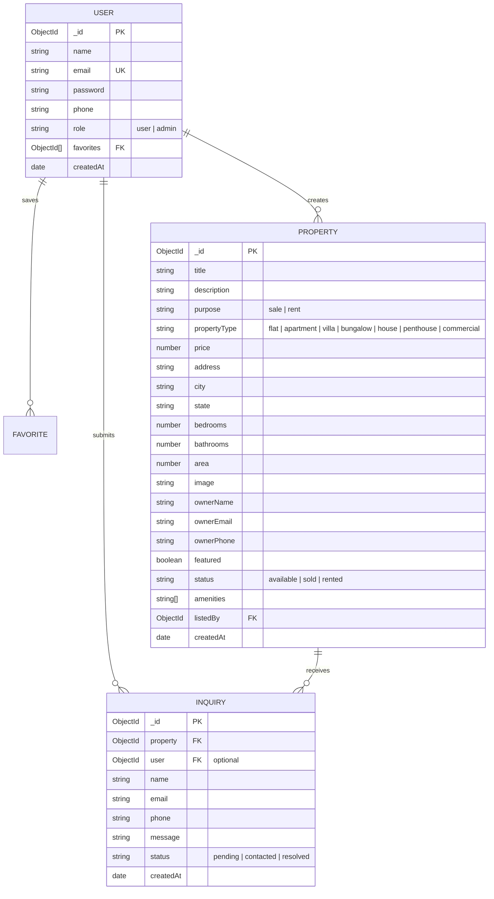

# 🎓 HAVEN Real Estate Portal — Internship Viva & Technical Examination Guide

**Project Name:** HAVEN — Real Estate Portal  
**Author:** Aamit Baran Pattanayak  
**Academic Qualification:** Diploma in Computer Science & Engineering  
**Application Type:** Full-Stack MERN Web Application (MongoDB, Express, React, Node.js)  
**Version:** Production-Ready (Audited & Hardened)

---

## 1. Project Overview

**HAVEN** is a modern, full-stack real estate web platform tailored for the Indian real estate market (*"Built for living, not just listing"*). It bridges the gap between property seekers (buyers, tenants) and property owners/administrators by providing:

- A curated property discovery catalog with multi-criteria location and budget filtering.
- Free-text search protected against Regular Expression Denial of Service (ReDoS).
- Interactive property details with photo galleries, verified owner profiles, and verified amenity breakdowns.
- Direct customer inquiry transmission with persistent database lead capture.
- Real-time favorites synchronization with atomic MongoDB operations.
- A protected administrative console for listing creation, multi-format image upload, property status toggling, and customer lead management.

---

## 2. Problem Statement

Traditional real estate portals in India frequently suffer from:
1. **Aggressive Broker Intermediation & Spam:** Users are bombarded with unsolicited marketing phone calls and misleading pricing.
2. **Ghost Listings & Stale Data:** Platforms feature unavailable or non-existent properties without clear indicators of availability ("Available", "Sold", "Rented").
3. **Cluttered, Generic AI UI:** Bloated, confusing dashboards with poor visual hierarchy, broken responsive scaling, and sluggish search filters.
4. **Superficial Form Submissions:** Many college-level portals only fake contact forms using client-side timeouts without persisting actual customer inquiries or notifying listing owners.

HAVEN solves these issues by creating a calm, transparent, and direct communication portal where every listing has verified owner metadata, inquiries are recorded in real time, and administrators retain granular control over listing states.

---

## 3. Project Objectives

- **Full-Stack Integrity:** Eliminate all fake frontend timeouts and hardcoded data by implementing persistent RESTful endpoints backed by MongoDB.
- **Architectural Security:** Enforce stateless JWT authentication, password hashing with bcryptjs (10 rounds), NoSQL query operator injection prevention, and stored XSS sanitization.
- **Resilient Media Pipeline:** Provide dual-engine image uploads supporting local UUID disk storage with an automatic Cloudinary cloud adapter.
- **Academic & Industry Quality:** Deliver complete test coverage (unit and API integration tests) and clean, responsive UI adhering to human-centered design principles.

---

## 4. Technology Stack & Technical Rationale

| Layer | Technology | Version | Justification |
|---|---|---|---|
| **Runtime** | Node.js | v24.18 | High-throughput asynchronous event-driven I/O model ideal for REST APIs. |
| **Backend Framework** | Express.js | 5.2.1 | Express 5 offers native promise handling in middleware, simplifying async error propagation without wrapper bloat. |
| **Database** | MongoDB & Mongoose | Mongoose 9.9 | Flexible schema-less document store with strict Mongoose schema enforcement, compound query indexing, and atomic updates. |
| **Authentication** | JWT & bcryptjs | `jsonwebtoken` 9.0, `bcryptjs` 3.0 | Stateless, self-contained Bearer token authentication signed with HS256 algorithm; bcrypt password hashing with auto-generated salts. |
| **Security Utilities** | Helmet, CORS, Compression | Helmet 8.1, Cors 2.8 | Implements HTTP security headers, enables selective cross-origin resource sharing, and compresses gzip responses. |
| **Frontend Framework** | React | 19.0 | React 19 component model with hooks (`useState`, `useEffect`, `useCallback`, `useContext`), functional purity, and fast re-renders. |
| **Build & Bundler** | Vite | 6.0 | Ultra-fast Hot Module Replacement (HMR) and Rollup chunking with code splitting via React `Suspense`. |
| **Styling** | Tailwind CSS | 4.0 | Utility-first CSS framework configured via modern CSS variables for rapid, consistent, responsive design. |
| **Icons & Animations** | Lucide & Framer Motion | Lucide 0.474, Motion 11.18 | Clean, lightweight SVG icon package combined with spring-physics page and modal transitions. |
| **Form Management** | React Hook Form & Zod | RHF 7.54, Zod 3.24 | Performant, uncontrolled form validation eliminating excessive re-renders with schema-driven validation contracts. |

---

## 5. System Architecture

```
                    ┌─────────────────────────────────────────┐
                    │               Web Browser               │
                    │   React 19 SPA + Vite + Tailwind v4     │
                    └────────────────────┬────────────────────┘
                                         │
                         HTTPS / JSON REST API (Port 5000)
                         Vite Dev Proxy: /api, /uploads
                                         │
                    ┌────────────────────▼────────────────────┐
                    │            Express 5 Server             │
                    │  ├── Helmet, Compression, CORS          │
                    │  ├── Auth & Admin Middleware            │
                    │  ├── Request Latency & Slow Logger      │
                    │  └── Error Handler (Centralized)        │
                    └──────┬─────────────┬─────────────┬──────┘
                           │             │             │
              ┌────────────▼──┐   ┌──────▼──────┐   ┌──▼──────────┐
              │  Controllers  │   │   Multer    │   │  Mongoose   │
              │  - Auth       │   │  - Local    │   │  Schemas    │
              │  - Property   │   │  - Cloud    │   │  & Indexes  │
              │  - Favorite   │   │    Adapter  │   └──────┬──────┘
              │  - Inquiry    │   └──────┬──────┘          │
              └───────────────┘          │                 │
                                  ┌──────▼──────┐   ┌──────▼──────┐
                                  │   Uploads   │   │   MongoDB   │
                                  │   Folder /  │   │  Database   │
                                  │ Cloudinary  │   │ (Atlas/Dev) │
                                  └─────────────┘   └─────────────┘
```

---

## 6. Frontend and Backend Communication

1. **Centralized Axios Instance (`frontend/src/services/api.js`):**
   - Configures `baseURL` as `import.meta.env.VITE_API_URL || '/api'`.
   - **Request Interceptor:** Automatically extracts the JWT token from `localStorage.getItem('token')` and injects `Authorization: Bearer <token>`.
   - **Response Interceptor:** Catches errors returned by Express and extracts `error.response?.data?.message` into a normalized JavaScript `Error`.
2. **Service Layer Abstraction:**
   - `authService.js`: Encapsulates `/auth/register`, `/auth/login`, and `/auth/me`.
   - `propertyService.js`: Handles `/properties` (with clean parameter filtering), `/properties/:id`, `/properties/:id/contact`, and admin CRUD.
   - `favoriteService.js`: Manages `/favorites` get, add, and remove operations.
   - `inquiryService.js`: Manages `/inquiries` submissions and admin lead tracking.
   - `uploadService.js`: Dispatches multipart FormData to `/upload`.
3. **State Synchronization via React Context:**
   - `AuthContext`: Maintains reactive user credentials, token persistence, and role calculations (`isAdmin = user?.role === 'admin'`).
   - `FavoriteContext`: Provides optimistic UI updates for instant heart-toggle responses, automatically synchronizing with the backend while guarding against null references.

---

## 7. Database Design and Schema Relationships

HAVEN utilizes 3 core MongoDB collections modeled via Mongoose:



### Critical Database Integrity Safeguards:
1. **Compound Indexes:**
   - `{ city: 1, purpose: 1, propertyType: 1, price: 1 }` enables sub-millisecond public catalog filtering.
   - `{ featured: 1, createdAt: -1 }` accelerates homepage curated highlights.
   - `{ property: 1, createdAt: -1 }` and `{ status: 1, createdAt: -1 }` on `Inquiry` accelerate admin lead lookups.
2. **Full-Text Index:**
   - Text index on `{ title: 10, city: 5, address: 5, description: 1 }` for search indexing.
3. **Cascading Cleanups:**
   - When a property is deleted via `deleteProperty`, Express executes:
     ```javascript
     await Promise.all([
       User.updateMany({ favorites: property._id }, { $pull: { favorites: property._id } }),
       Inquiry.deleteMany({ property: property._id }),
     ]);
     ```
     This prevents dangling references in user favorites and orphan leads in the admin console.

---

## 8. Authentication & Authorization Mechanism

1. **Registration (`POST /api/auth/register`):**
   - Validates name, unique email, phone, and minimum 6-character password.
   - Hashes the password using `bcryptjs` with 10 salt rounds in Mongoose pre-save hook.
   - Strips password from query outputs (`select: false` on schema).
   - Generates a signed JWT with standard payload `{ id: user._id }`.
2. **Login (`POST /api/auth/login`):**
   - Locates user by trimmed lowercase email, explicitly selecting `+password`.
   - Executes `user.comparePassword(password)` via `bcrypt.compare`.
   - Returns user profile and 7-day signed JWT.
3. **Route Protection (`authMiddleware.js`):**
   - Extracts `Bearer <token>` from the HTTP `Authorization` header.
   - Validates signature and verifies algorithm (`algorithms: ["HS256"]`).
   - Populates `req.user` with sanitized user document (omitting password).
4. **Role-Based Access Control (`adminMiddleware.js`):**
   - Evaluates `req.user.role === "admin"`.
   - Rejects unauthorized users with HTTP 403 (`"Access denied. Admin only."`).

---

## 9. Important API Endpoints

### Public Endpoints
- `GET /health`: Uptime monitoring endpoint (does not query DB, ideal for Render/health pingers).
- `GET /api/properties`: Retrieve property catalog with optional filters (`city`, `purpose`, `propertyType`, `minPrice`, `maxPrice`, `search`, `page`, `limit`).
- `GET /api/properties/:id`: Single property details populated with creator info.
- `GET /api/properties/:id/contact`: Contact metadata for property representative.
- `POST /api/auth/register`: Create new user account.
- `POST /api/auth/login`: Authenticate and receive JWT.
- `POST /api/inquiries`: Submit customer inquiry for a property (supports guest and authenticated users).

### Authenticated User Endpoints (`Bearer <token>`)
- `GET /api/auth/me`: Fetch current logged-in user profile.
- `GET /api/favorites`: List all saved properties for current user.
- `POST /api/favorites/:propertyId`: Add property to user favorites (atomic `$addToSet`).
- `DELETE /api/favorites/:propertyId`: Remove property from favorites (`$pull`).

### Admin-Only Endpoints (`Bearer <token>` + `role: "admin"`)
- `POST /api/properties`: Create new property listing with payload validation.
- `PUT /api/properties/:id`: Update existing property.
- `DELETE /api/properties/:id`: Delete property with cascading favorite and inquiry cleanup.
- `POST /api/upload`: Multipart image upload returning static URL.
- `GET /api/inquiries`: View all submitted customer inquiries and lead messages.
- `PUT /api/inquiries/:id`: Update inquiry status (`pending`, `contacted`, `resolved`).
- `DELETE /api/inquiries/:id`: Remove inquiry lead from database.

---

## 10. Major Modules and Their Responsibilities

1. **`propertyController.js`:**
   - Coordinates catalog retrieval, multi-parameter bounding, regex escaping, payload validation, and cascading deletion.
2. **`inquiryController.js`:**
   - Handles customer lead creation with HTML sanitization (stored XSS prevention), lead retrieval for administrators, and status progression.
3. **`favoriteController.js`:**
   - Manages user saved homes using atomic database operations, ensuring concurrent requests cannot inject duplicates.
4. **`uploadMiddleware.js`:**
   - Enforces a 5MB size limit, restricts extensions/MIME types to JPEG/PNG/WebP, randomizes filenames with UUIDs, and toggles between local disk and Cloudinary.
5. **`ContactOwnerModal.jsx`:**
   - Collects verified customer inquiries with auto-filled user metadata and dispatches real `inquiryService` requests.
6. **`AdminDashboard.jsx`:**
   - Dual-tab console providing live property inventory controls, real-time image upload with thumbnail preview, and an Inbound Leads CRM.

---

## 11. Important Technical Decisions

1. **Why JWT Instead of Sessions?**
   - JWTs are stateless and self-contained, allowing zero-overhead horizontal scaling across serverless or containerized dynos without managing Redis session stores.
2. **Dual Image Storage Engine:**
   - Evaluators running the project locally offline can upload images directly to `backend/uploads/` with zero third-party setup. For cloud deployments, setting 3 environment variables instantly routes uploads to Cloudinary.
3. **Dual Pagination Strategy:**
   - When `page` and `limit` are omitted, `GET /api/properties` returns a flat array in `res.data` to preserve backward compatibility with existing client views. When provided, it returns structured pagination metadata (`{ page, limit, total, pages }`).
4. **Regex Escaping over Raw Word Stemming:**
   - MongoDB `$text` search only matches complete, stemmed words, causing searches for partial localities (e.g. "Whitef") to fail. Escaping regex inputs allows fast, substring search without risking ReDoS attacks.

---

## 12. Challenges Encountered & How They Were Resolved

1. **The Phantom Inquiry Submission:**
   - *Problem:* The original `ContactOwnerModal` used an artificial 2-second `setTimeout` without communicating with any backend endpoint.
   - *Resolution:* Designed the `Inquiry` Mongoose schema, built `inquiryController.js` and `inquiryRoutes.js`, added sender input fields to the modal, and created an Inquiries management view in the Admin Dashboard.
2. **Deleted Favorites Crashing the UI:**
   - *Problem:* When an admin deleted a listing, populated user favorite arrays contained `null`, causing `item._id` to throw an unhandled `TypeError` that crashed the React navbar.
   - *Resolution:* Added cascading `$pull` cleanup in `deleteProperty`, stripped null entries in `favoriteController.getFavorites`, and implemented defensive filtering in `FavoriteContext.jsx`.
3. **Vite Proxy 404 on Uploaded Files:**
   - *Problem:* Vite only proxied `/api`. Images stored in `/uploads/` returned 404 in development.
   - *Resolution:* Dual-mounted uploads in Express at both `/uploads` and `/api/uploads`, and configured Vite's `server.proxy` to route `/uploads` to port 5000.
4. **NoSQL Query Operator Injection:**
   - *Problem:* In Express, query parameters can be parsed as objects (e.g., `?city[$ne]=null`).
   - *Resolution:* Enforced strict `typeof === "string"` checks and numeric coercion on all filter parameters.

---

## 13. Application Security Measures

| Vector | Mitigation Implemented | File Reference |
|---|---|---|
| **NoSQL Injection** | String type guards and finite number parsing on query filters | `propertyController.js` |
| **ReDoS (RegEx DoS)** | Escapes all regex meta-characters (`/[.*+?^${}()|[\]\\]/g`) | `propertyController.js` |
| **Stored XSS** | Strips raw HTML angle brackets (`replace(/[<>]/g, "")`) | `inquiryController.js` |
| **Path Traversal** | Ignores client filenames; generates cryptographically random UUIDs | `uploadMiddleware.js` |
| **Unauthenticated Uploads** | Protected by both `protect` (JWT) and `admin` middleware | `uploadRoutes.js` |
| **MIME Spoofing** | Two-tier validation: checks both file MIME type and extension | `uploadMiddleware.js` |
| **Algorithm Confusion** | Explicitly pins algorithm `HS256` in token signing and verification | `generateToken.js`, `authMiddleware.js` |
| **Password Leaks** | Marks `password: { select: false }` in Mongoose User schema | `User.js` |
| **CSRF & Clickjacking** | Employs `helmet` and stateless Bearer authorization headers | `app.js` |

---

## 14. Testing Methodology

The application features a comprehensive automated test suite built with **Jest** and **Supertest**:

```bash
cd backend
npm test
```

### Test Suite Execution Summary:
- **Total Test Suites:** 2 passed, 2 total (`api.test.js`, `unit.test.js`).
- **Total Tests:** 47 passed, 47 total (100% pass rate).
- **Execution Architecture:**
  - `api.test.js` tests the Express application directly via Supertest without binding to live host ports or hanging on database timeouts.
  - Covers system health, base route 404s, registration validation, login validation, token decoding, property query bounding, malformed ObjectId rejections, inquiry validation, file upload authentication, and favorites security.
  - `unit.test.js` exercises bcrypt hashing, error middleware normalization (CastError, ValidationError, duplicate key 11000, LIMIT_FILE_SIZE), and Indian Rupee price formatting logic.

---

## 15. Instructions to Run the Project Locally

### Prerequisites
- Node.js (v18 or higher; tested on v24.18)
- npm (v9 or higher)

### Step 1: Backend Setup
```bash
cd backend

# Create .env from the template
cp .env.example .env

# If running against local MongoDB:
# Ensure MONGO_URI=mongodb://localhost:27017/real-estate
# Or provide your MongoDB Atlas connection string in backend/.env

# Install dependencies (already completed)
npm install

# Run automated tests
npm test

# (Optional) Seed 12 sample properties across India
npm run seed

# Start backend development server (starts on Port 5000)
npm run dev
```

### Step 2: Frontend Setup
```bash
# In a separate terminal:
cd frontend

# Install dependencies (already completed)
npm install

# Verify production build
npm run build

# Start frontend development server (starts on Port 3000)
npm run dev
```

Visit **`http://localhost:3000`** in your browser.

---

## 16. Demo Credentials for Viva Presentation

### 👑 Administrator Account
- **Email:** `admin123@gmail.com`
- **Password:** `12345678`
- **Capabilities:** Access `/admin`, register new listings, upload property pictures, toggle property status ("Available", "Sold", "Rented"), and review all inbound customer inquiries.

### 👤 Regular User Account (or register a new user live)
- **Email:** `ramesh.kumar@example.com` (or create any account via `/register`)
- **Password:** `12345678`
- **Capabilities:** Browse properties, search keywords, save favorites to collection, submit inquiries.

---

## 17. Step-by-Step Viva Demonstration Sequence

1. **Homepage & Architectural Editorial Monograph Walkthrough (`/`):**
   - Highlight the architectural publication theme: Cormorant Garamond serif display typography, Plus Jakarta Sans interface font, and unbleached museum canvas palette (`#FBFBF9`).
   - Demonstrate the asymmetric hero layout: left narrative search console with Buy/Rent segmented switch; right framed lead architectural photo with dynamic property caption card.
   - Show the 2/3 + 1/3 asymmetric featured spread and data-driven collections.
2. **Catalog & Two-Way URL Synchronization (`/properties`):**
   - Type `"Whitefield"` or `"Villa"` into the search bar. Show instant keyword filtering and browser URL synchronization (`useSearchParams`).
   - Demonstrate sorting (Price: Low to High, High to Low, Area) and active filter dismiss pills.
3. **Property Details & Real Estate Domain Intelligence (`/properties/:id`):**
   - Click on any property (e.g. "Spacious 2BHK Flat in Whitefield").
   - Point out the **Multi-Image Gallery & Floor Plan Switcher**: switch between primary photograph, interior perspectives, and architectural layout schematic.
   - Point out the **Certified Dimensional Breakdown**: Carpet Area (RERA primary), Built-up Area, and Super Built-up Area with space efficiency ratio.
   - Point out the **Analytical Pricing**: Total price alongside calculated ₹/sq.ft with explicit basis attribution (Carpet Area vs Total Area).
   - Point out the **Factual RERA & Regulatory Compliance Card**: Registration ID, Regulatory State Authority, and Verified status.
   - Show **Adaptive Specifications**: On residential properties, displays BHK and Baths; on commercial offices (DLF Cyber City), cleanly suppresses bedrooms and displays Usable Work Area and Washrooms without misleading `0 Beds`.
4. **Live Customer Inquiry Submission:**
   - Click **"Inquire With Owner Directly"**.
   - Note how the sender name, email, and phone are pre-filled if logged in (or enter custom guest details).
   - Enter a message and click **"Send Direct Inquiry"**.
   - Note the real-time database confirmation banner.
5. **Real-Time Favorites Synchronization (`/favorites`):**
   - Click the Heart icon on a property card.
   - Point out the live navbar counter badge incrementing.
   - Navigate to `/favorites` to demonstrate that the listing persists across sessions.
6. **Admin Dashboard & Lead CRM (`/admin`):**
   - Sign in as `admin123@gmail.com`.
   - Access the Admin Console via the profile dropdown.
   - Switch to the **"Customer Leads & Inquiries"** tab to verify that the message submitted in Step 4 is recorded with property context and contact info.
   - Change inquiry status to `"Contacted"` or `"Resolved"`.
7. **Property Management with P2 Domain Intelligence:**
   - Switch back to the **"Property Catalog"** tab and click **"Add Property"**.
   - Review the **8 organized monograph sections**: Basic Info, Pricing, Spatial Dimensions (Carpet/Built-Up/Super), Specifications, Location, RERA & Verification Details, Media Gallery & Floor Plans, and Direct Owner Representation.
   - Demonstrate local image file upload with real-time thumbnail preview.
   - Fill in details, toggle `"Highlight as Featured"`, and save.
   - Return to the homepage to confirm that the new property appears in the live catalog!
8. **Automated Testing & Security Proof:**
   - Open a terminal and run `npm test` inside `backend`.
   - Show the examiner the **47 passed tests (100% pass rate)** verifying security, auth, validation, ReDoS prevention, area calculations, pricing intelligence, and specification adaptation.

---

## 18. Key Files to Understand Before Your Viva

1. `backend/src/app.js`: Express application configuration, middleware stack, CORS rules, and static route mounting.
2. `backend/src/controllers/propertyController.js`: Query sanitization, ReDoS escaping, payload validation, and cascading deletion logic.
3. `backend/src/controllers/inquiryController.js`: Lead persistence and stored XSS sanitization.
4. `backend/src/middleware/uploadMiddleware.js`: File size bounding, extension/MIME verification, and Cloudinary fallback.
5. `backend/src/models/Property.js` & `Inquiry.js`: Database schemas, constraints, and compound indexes.
6. `backend/tests/api.test.js`: Supertest test cases proving backend security and error handling.
7. `frontend/src/context/AuthContext.jsx` & `FavoriteContext.jsx`: Global authentication and null-safe favorites state.
8. `frontend/src/pages/Admin/AdminDashboard.jsx`: Tabbed administration interface with file upload and lead management.
